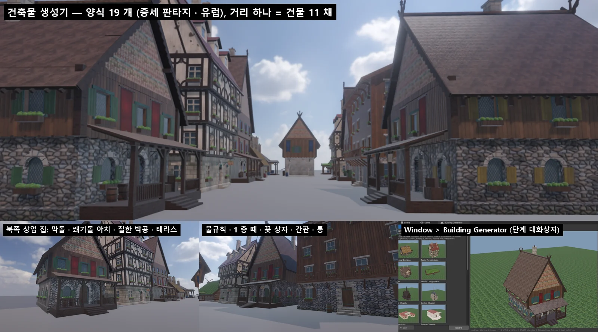

# 건축물 생성기 (Building Generator)

NOVA 의 건물은 모델 파일 없이 **식으로** 짓습니다. 값 한 벌 (`BuildingDesc`) 에서 메시를 만들고, 재질은 **텍스처 팩** (사진 PBR 재질) 을 그대로 씁니다. 장면에는 값만 저장하고, 열 때 다시 짓습니다.

## 패키지

| 패키지 | 내용 |
|---|---|
| `com.nova.building` (Building Generator) | `NovaBuilding.dll` — Building 컴포넌트 · Window > Building Generator · GameObject > 3D Object > Building · `.building` 프리셋 · CLI `nova building`. 종속: `com.nova.textures` |
| `com.nova.textures` (Texture Pack — Materials) | CC0 PBR 재질 85 개 (ambientCG) — 지붕 35 (RoofingTiles 전부 · 이엉 · 너와) · 돌 19 · 벽돌 5 · 회벽 7 · 나무 11 · 금속 5 · 땅 · 자연. 1024² WebP 48 MB, `catalog.json` 의 id 로 찾는다 — [목록](../Packages/com.nova.textures/README.md) |

Window > Package Manager 또는 `nova package add com.nova.building` (텍스처 팩도 같이 들어온다).

## 텍스처 팩 재질 (그대로)

- 재질 칸마다 텍스처 팩 id (예 `roof/clay-tiles-mossy`). 고르지 않으면 벽 · 지붕 재질 종류의 기본 id (막돌 → `stone/rubble-wall`, 이엉 → `roof/thatch` …). `procedural` = 식으로 굽는 재질 (유리 · 깃발 · 칠한 무늬 · 꽃 — 팩에 없는 것)
- **사진 원본을 바꾸지 않는다**: 색 · DirectX 노멀 · 거칠기 (Smoothness = 1 - 거칠기) · AO · 금속 · 높이 그대로. 양식 색은 식으로 굽는 재질에만 곱한다
- **형식만 바꾼다**: 엔진이 WebP 를 직접 읽고 (libwebp — `ImageIO`), 처음 쓸 때 RGBA8 로 바로 올린 뒤 뒤에서 BC 압축 (색 BC1 · 노멀 BC7 · 마스크 BC3 · 높이 BC4) 해 프로젝트 `Library/NovaBuilding/TextureCache` 에 캐시 — 다음부터 캐시 (VRAM 1/4). 편집기를 닫으면 남은 압축은 취소 (기다리지 않는다)
- **가까운 곳 테셀레이션**: 높이 맵이 있는 깊은 재질 (막돌 5.5 cm · 기와 5 cm · 이엉 6 cm · 슬레이트 · 너와 · 마름돌 · 벽돌) 은 22 m 안에서 삼각형을 나눠 높이만큼 민다 (엔진 Tessellation — 노멀맵만으로 모자란 깊이)
- 재질 칸 · 분류 (편집기 7 단계 Materials, CLI `nova building materials`):

| 칸 (key) | 어울리는 분류 |
|---|---|
| wallLower · wallUpper | stone · brick · plaster · wood |
| trim | stone · brick |
| roof | roof · metal · ground |
| timber · frame · door · shutter | wood |
| metal | metal |



## 양식 19 개

| 갈래 | 양식 |
|---|---|
| 중세 판타지 | Medieval Cottage (막돌 · 이엉) · Tudor Townhouse (돌출 층 · 튜더 반목조) · Tavern (L 자 여관 · 테라스 · 간판) · Castle Keep (총안 · 모서리 원탑) · Watchtower (화살 구멍) · Wizard Tower (가늘어지고 휜 탑) · Market Hall (열린 아케이드) · Blacksmith (장작 · 통 · 헛간) · Windmill (풍차 날개) |
| 북유럽 | Nordic Longhouse (통나무 · 잔디 지붕 · 조각 박공) · Stave Church (층층 지붕 · 용머리 · 첨탑) · **Northern Merchant House** · **Northern Gatehouse** (북쪽 상업 도시 — 막돌 아래층 · 판자 위층 · 가파른 너와 · 처마 까치발 · 조각 · 칠한 박공 · 깃발) |
| 로마 | Roman Villa (U 자 · 주랑) · Roman Temple (기단 · 둘레 기둥 · 박공) |
| 고딕 · 바로크 | Gothic Chapel (첨두 창 · 버팀벽 · 장미창 · 종탑) · Baroque Palace (벽기둥 · 박공 창 · 맨사드 · 구리 돔) |
| 그 밖 유럽 | Alpine Chalet (넓은 처마 · 발코니) · Mediterranean House (흰 회벽 · 아치 창 · 파란 덧창) |

양식은 출발점입니다. 모든 값을 바꿀 수 있고, **Randomize** (seed) 는 양식 안에서 크기 · 층 · 물매 · 지붕창 · 색을 조금씩 바꿉니다. 마을을 채워도 같은 집이 줄지어 보이지 않습니다.

## 값

| 묶음 | 값 |
|---|---|
| 형태 | 평면 (사각 · L · T · U · 안뜰 · 십자 · 원) · 너비 · 깊이 · 날개 폭 · 길이 · 층 수 · 층 높이 · 밑돌 · 돌출 층 (Jetty) · 탑 좁아짐 · 모서리 탑 (0 · 1 · 2 · 4, 원 · 팔각 · 사각, 지붕) |
| 벽 | 1 층 · 위층 재질 (막돌 · 마름돌 · 벽돌 · 회벽 · 스투코 · 판자 · 통나무 · 대리석) · 반목조 무늬 (격자 · X · 셰브런 · 튜더 곡선) · 모서리 돌 · 층 띠 · 처마 돌림띠 · 벽기둥 · 버팀벽 |
| 창 · 문 | 위층 · 1 층 창 모양 (네모 · 아치 · 첨두 · 둥근 · 돌 창살 · 바로크 · 화살 구멍) · 크기 · 간격 · 창턱 높이 · 덧창 · 납틀 유리 · 창 박공 · 장미창 · 문 (판자 · 아치 · 두 짝 · 큰 문) |
| 지붕 | 박공 · 모임 · 맨사드 · 갬브럴 · 평 · 외쪽 · 사각뿔 · 원뿔 · 돔 · 양파 · 층층 (스타브) · 재질 (기와 · 슬레이트 · 이엉 · 너와 · 구리 · 납 · 잔디) · 물매 · 처마 · 계단 박공 · 지붕창 · 굴뚝 · 용머리 · 첨탑 · 가운데 돔 |
| 목공 · 장식 | 처마 까치발 + 서까래 끝 + 벽 위 도리 + 박공 도리 끝 · 박공 판 (곧은 · 조각 — 꼭대기에서 뿔처럼 엇갈림) · 박공 꼭대기 장식 · 칠한 박공 (북유럽 무늬 판) · 굵은 모서리 기둥 (통나무 벽은 엇갈린 통나무 끝) |
| 앞 꾸밈 · 소품 | 문 지붕 (기둥 둘 · 작은 박공) · 지붕 덮인 테라스 (마루 · 기둥 · 까치발 · 난간 · 계단) · 문 옆 등 · 내건 간판 · 깃발 (창 사이, 제비꼬리) · 꽃 상자 · 소품 (통 · 장작 더미와 작은 지붕 · 상자 더미) · 옆 헛간 (외쪽 지붕 — 비대칭) |
| 나이 · 성격 | **Weathering** (1 층 벽 아래로 진해지는 흙 튐 · 물 얼룩 · 이끼) · **Irregularity** (위층 기울기 · 용마루 처짐 · 벽의 낮은 흔들림 · 문이 한가운데가 아님 · 창 자리 · 높이 어긋남 · 가끔 빠진 창) |
| 색 | 1 층 벽 · 위층 벽 · 장식 돌 · 들보 · 지붕 · 창틀 · 덧창 · 문 · 유리 · 금속 · 칠한 무늬 (흰색 = 본래 색) · 깃발 — 색 묶음 8 개 (Medieval Village · Dark Fantasy · Nordic · Mediterranean · Baroque Pastel · Elven · Royal · Desert Fort) |

## 쓰는 법

- **GameObject > 3D Object > Building >** 양식 이름 — 그 양식의 건물 (Mesh Filter + Mesh Renderer + Building + Mesh Collider — 문 · 아치로 걸어 들어간다).
- **Window > Building Generator** — 단계 대화상자: 1 양식 갤러리 (양식마다 미리 본 썸네일) → 2 형태 · 크기 → 3 벽 → 4 창 · 문 → 5 지붕 → 6 장식 (목공 · 앞 꾸밈 · 소품 · 나이) → 7 색 → 8 완성. 오른쪽은 3D 미리 보기 (끌기 = 돌리기, 휠 = 확대, Front · Corner · Top · Turntable). 값을 바꾸면 바로 다시 짓습니다.
  - **Create in Scene** — 장면에 만들기 (옆으로 비켜 가며). **Apply to Selected Building** · **Live** — 고른 건물을 그 자리에서 고친다 (Undo 됨).
  - **Presets** — `Assets/Buildings/*.building` (JSON). Project 창 Create > Building Preset, 두 번 누르면 생성기로 열린다.
- **Building 컴포넌트 Inspector** — 양식 · seed · Randomize · 크기 · 지붕 + **Open Building Generator** (그 건물을 Live 로 연다).

## 만드는 방법

- **날개**: 평면을 사각 날개들로 (L · T · U · 안뜰 · 십자). 날개마다 층 · 면 띠를 짓고, 지붕을 얹는다. 둥근 평면은 탑 몸채 (앞 면은 문이 들어갈 만큼 넓게).
- **구멍**: 벽 띠를 창 · 문 둘레의 열로 잘라 짓는다 (아치 · 첨두 · 활꼴 · 둥근 창도 틈 없이). 구멍 안쪽 면 · 유리 / 문짝 · 창틀 · 창턱 · 덧창. 석조 벽의 아치에는 **쐐기돌** (길이로 고르게 나눠, 가운데 이맛돌이 크다) · **문설주 돌** (길고 짧게 번갈아) · 네모 창의 **상인방 돌**. 목조 벽의 문은 굵은 문설주 + 양쪽으로 내민 상인방, 판자 · 통나무 벽의 창은 칠한 창틀 판.
- **지붕**: 두께 있는 판 (윗면 = 지붕 재질, 아랫면 · 가장자리 = 나무). 처마 밑에 도리 · 서까래 끝 · 굽은 까치발 (2 차 곡선), 박공 끝에 도리 끝 · 조각 박공 판 (물결 아래 끝) · 꼭대기 장식.
- **헛간**: 생성기를 한 번 더 돌려 (1 층 판자 · 외쪽 지붕) 본채 옆에 돌려 붙인다. 그 자리의 본채 창은 내지 않는다.
- **불규칙**: 다 지은 뒤 모든 정점을 같은 매끈한 식으로 옮긴다 (위층 기울기 · 용마루 처짐 · 낮은 주파수 흔들림) — 틈이 생기지 않는다. 둥근 탑은 위로 갈수록 휜다 (마법사 탑).
- **메시**: 재질 칸 14 개 (1 층 벽 · 위층 벽 · 장식 돌 · 들보 · 지붕 · 유리 · 창틀 · 덧창 · 문 · 금속 · 천 · 칠한 무늬 · 깃발 · 잎) 마다 서브셋, 정점 65535 개마다 나눈다 (16 비트 인덱스 + VertexStart).

## 식으로 굽는 재질 (BuildingTextures — 팩에 없을 때)

종류 24 개 (막돌 · 마름돌 · 벽돌 · 회벽 · 스투코 · 판자 · 통나무 · 대리석 · 기와 · 슬레이트 · 이엉 · 너와 · 구리 · 납 · 잔디 · 들보 · 유리 · 납틀 유리 · 문 판자 · 금속 · 천 · 칠한 무늬 판 · 깃발 · 잎) 를 이어지는 타일로 굽는다. 벽 · 지붕 · 들보는 1024², 나머지 512² (밉맵 포함).

- **Base Map**: 밝은 중성 무늬 — 재질 Base Color (고른 색) 를 곱한다. 칠한 무늬 · 잎은 색이 들어 있다.
- **Normal Map**: 높이 무늬 (줄눈 · 돌 배 · 기와 단 · 나뭇결) 에서. 탄젠트 = 면 위 가로, B = 아래 · 비탈 아래.
- **Mask**: r = Metallic, g = Occlusion (틈), a = Smoothness — Metallic Map · Occlusion Map 칸에 같은 텍스처.
- **낡음** (모든 종류): 잔 표면 (정 자국 · 결) · 깨진 자리 · 큰 색 얼룩 · 틈의 때 · 빗물 줄. 노멀은 1.6 배.
- **1 층 때**: 1 층 벽은 텍스처 한 장 = 1 층 높이 (무늬는 세로로 여러 번 — 크기 그대로) 로 굽고, 아래로 진해지는 흙 튐 · 물 얼룩 · 이끼를 넣는다 (Weathering 0 ~ 1, 4 단계).
- UV 는 미터 — 재질 Tiling = 1 / 타일 크기. 종류 · 색 · 때가 같으면 같은 재질 (캐시).

Release 에서 1024² 한 종류를 굽는 데 약 0.2 초 (처음 한 번). 건물 하나 2 만 ~ 6 만 삼각형, 짓는 데 5 ~ 150 ms (Debug).

## CLI

```bash
nova building styles
nova building check --seeds 3
nova building create --style "Northern Merchant House" --seed 7 --position 0,0,0
nova building set --target "Northern Merchant House" --values '{"shape":{"floors":3},"details":{"irregularity":0.8}}'
nova building info --target "Northern Merchant House"
nova building window --style "Tudor Townhouse" --step 5
nova building preset --target "Northern Merchant House" --name "My House"
nova building materials --target "Northern Merchant House"
nova building set --target "Northern Merchant House" --values '{"materials":{"roof":"roof/thatch-mossy","wallLower":"stone/rubble-wall-dark"}}'
nova textures search --query "mossy roof tiles"
```

- `check` — 양식마다 기본 + 무작위 변형을 지어 빈 메시 · NaN · 잘못된 인덱스 · 크기 · 문 없음을 찾는다.
- `set --values` — BuildingDesc JSON 의 일부 (묶음 `shape` · `towers` · `walls` · `windows` · `roof` · `details` · `colors`) 만 덮어쓴다. `{"style": "Tavern"}` 만 주면 그 양식으로.

## 검사

`Tools/tests/run_tests.ps1 -Only building` — 양식 19 개, 모든 양식 · 무작위 변형의 메시 검사, 같은 seed = 같은 건물, 층 수가 높이를 바꿈, 세부 (까치발 · 박공 판 · 테라스 · 깃발 · 소품 · 꽃 상자) 가 메시를 더함, 불규칙, 프리셋 저장 · 불러오기, 장면 저장 → 열기, Game 뷰에 그려짐 · 생성기 창.
