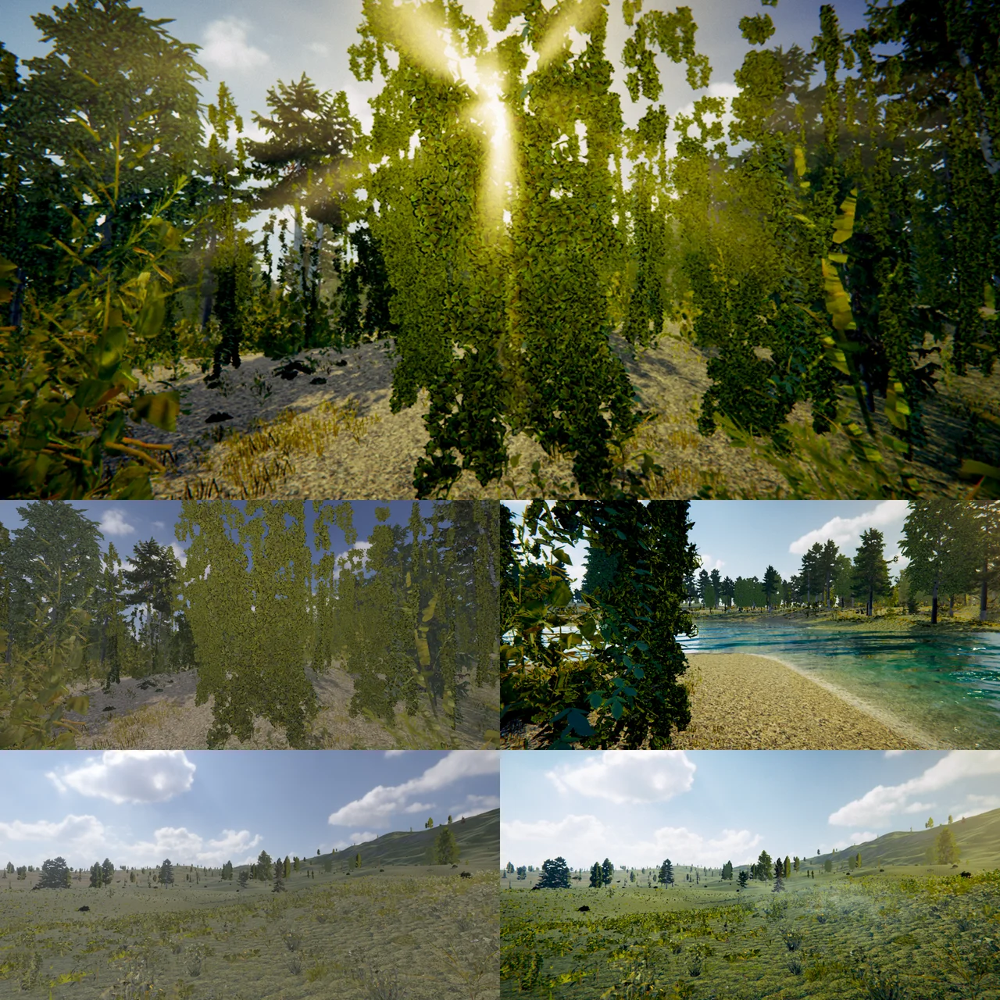

# 후처리 (Volume) — Unity URP 오버라이드 전부 + 숲의 빛

Volume 프로필 (`.volumeprofile`) 의 Add Override 로 고르는 효과들입니다. 이름 · 범위 · 기본값 · 식은 Unity URP 와 같게 했고, 숲 · 열린 월드에 필요한 HDRP · 옛 Unity 효과 (Volumetric Fog, Sun Shafts) 를 더했습니다.

## 효과 목록

| 효과 | 하는 일 | 비고 |
|---|---|---|
| Bloom | 밝은 곳 번짐 (밉 체인) | URP |
| Tonemapping | Neutral · ACES | URP |
| Color Adjustments | Post Exposure · Contrast · Color Filter · Hue Shift · Saturation | URP |
| White Balance | Temperature · Tint (LMS) | URP |
| **Split Toning** | 어두운 곳 · 밝은 곳에 다른 색 (Soft Light, 회색 0.5 = 그대로), Balance | URP, 2026-10-10 |
| **Channel Mixer** | 출력 채널마다 입력 R · G · B 비율 (-200 ~ 200 %) | URP, 2026-10-10 |
| **Shadows Midtones Highlights** | 트랙볼 셋 (색 + 밝기) · 영역 경계 4 개 | URP (`PrepareShadowsMidtonesHighlights`), 2026-10-10 |
| **Lift Gamma Gain** | 트랙볼 셋 (어두운 곳 더하기 · 중간 거듭제곱 · 밝은 곳 곱하기) | URP (`PrepareLiftGammaGain`), 2026-10-10 |
| **Color Lookup** | LUT 텍스처 (Unity 가로 띠 N² × N, G 는 아래에서 위로) · Contribution. 톤매핑 뒤 감마 색에 | URP, 2026-10-10. 중립 LUT: `Resources/Textures/LUT/NeutralLUT32.png` |
| Vignette · Chromatic Aberration · Film Grain | | URP |
| **Lens Distortion** | Intensity · X / Y Multiplier · Center · Scale (URP `DistortUV`) | URP, 2026-10-10 |
| **Panini Projection** | 넓은 화각 가장자리 늘어짐 줄이기 · Crop To Fit | URP, 2026-10-10 |
| **Screen Space Lens Flare** | Bloom 밉의 밝은 곳 → 화면 가운데 건너편 고스트 (첫 · 둘째 · 휜), 줄기, 색수차, 가장자리 약하게 | URP 2023, 2026-10-10 — Bloom 이 켜져 있어야 |
| Depth Of Field · Motion Blur | Gaussian · Bokeh / 카메라 · 물체 | URP |
| Exposure | 고정 · 자동 | HDRP |
| Shadows | 캐스케이드 1 ~ 8, 거리 | URP (+ 8 개까지) |
| Fog | 높이 안개 · **Volumetric Fog** | HDRP |
| Atmosphere | 대기 원근 (레일리 · 미) | Unreal Sky Atmosphere |
| **Sun Shafts** | 해 둘레 밝은 하늘이 잎 · 가지 틈으로 새는 빛줄기 | Unity Standard Assets 의 Sun Shafts, 2026-10-10 |
| Screen Space Reflection · Ambient Occlusion · Indirect Lighting · Motion Vectors | | URP · HDRP |

차례 (Uber, URP LutBuilder 와 같음): Post Exposure → White Balance → Contrast · Color Filter → Split Toning → Channel Mixer → Shadows Midtones Highlights → Lift Gamma Gain → Hue · Saturation → 톤매핑 → Color Lookup. UV 는 Panini → Lens Distortion 순으로 옮긴다 (Bloom 도 같은 자리를 읽는다).

아직: **Color Curves** (곡선 편집기 — 곡선 8 개), Contact Shadows, 디퍼드 (G-버퍼) 의 잎 투과.

## 숲의 빛

- **Volumetric Fog** (Fog > Volumetric Fog · Albedo · Distance · Multiplier · Quality): 안개 패스 (50) 가 카메라에서 점까지 16 / 32 / 64 걸음, 걸음마다 해 (방향광 0) 의 캐스케이드 그림자 맵을 읽어 빛이 닿는 곳만 산란 (Henyey-Greenstein, Fog 의 Anisotropy). 밀도 = 높이 안개와 같은 식 × Multiplier. 걸음 시작을 픽셀 · 프레임마다 흔들어 TAA 가 매끈하게. Release 1080p 숲에서 안개 패스 전체 약 1 ms
- **Sun Shafts**: 1/4 해상도에서 하늘 (깊이 없음) 중 문턱 넘게 밝은 곳 × 해에서 거리 → 해 쪽 방사형 흐림 (반복마다 길게) → 해 색으로 더한다. 해가 옆 · 뒤면 없다. 0.07 ms
- **잎 투과** (PCG 식물 — 바람 묶음의 `PS_BatchFoliage`): 해를 등진 잎이 비쳐 밝게 (Unreal 의 Two Sided Foliage — 나무 컴포넌트와 같은 식). 포워드 (Forward · Forward+)

## 열린 월드의 숲 (GameObject > Open World)

Open World 를 만들면 `Assets/PCG/OpenWorldLook.volumeprofile` (Global, Priority 11) 이 같이 붙는다 (처음 만들 때만 값을 넣는다):
ACES · Bloom 0.45 · 대비 16 · 채도 22 · Split Toning (차가운 그늘 · 따뜻한 빛) · Lift Gamma Gain · Shadows Midtones Highlights (중간 밝기 초록) · 비네트 · 색수차 · 필름 그레인 · Lens Flare 0.1 · Sun Shafts 1.2 · Atmosphere · Fog (옅게) + Volumetric Fog (160 m, × 10) · SSR. 해 (Directional Light) 는 낮고 따뜻하게 (28°, 1.35).

- 숲 바닥은 40 m 이끼 덩어리와 낙엽이 섞인다 (`WorldGen::Splat`), 하층 식물을 더 빽빽하게 (PCG 프리셋)
- **물 빼기**: 호수 · 강 · 바다 (Water Body) 에 잠기는 PCG 점은 놓지 않는다 (Unreal PCG 처럼). 물을 옮기거나 더하면 그 둘레가 다시 채워진다 (`PCG::WaterMask`)

결과 (Release, GTX 1660 SUPER, 1143 x 572 Game 뷰): 해 쪽 숲 15.5 ms · 호숫가 14.6 · 초원 17.7. 후처리 전체 0.4 ms, 안개 + 볼륨 안개 1 ~ 1.6 ms.

## 검사

`run_tests.ps1 -Only postfx`: Unity 기본값 (트랙볼 (1,1,1,0) · 회색 0.5 · 100 %) = 같은 그림, Lift Gamma Gain 빨강 · Shadows Midtones Highlights 파랑 · Split Toning · Channel Mixer 가 바꾼다, 중립 LUT = 같은 그림, Lens Distortion · Panini 가 모양을 옮긴다, Sun Shafts 는 해를 볼 때만, Lens Flare 는 Bloom 위에, Volumetric Fog 는 같은 안개보다 해 쪽이 밝다.

## 파일

- `Source/Graphics/Common/VolumeProfile.*` (효과 · 매개변수, Trackball · Texture 종류), `Source/Editor/VolumeEditor.cpp` (트랙볼 · 텍스처 칸), `Source/Scene/Volume.cpp` (섞기)
- `Source/Graphics/DX11/PostProcessPass.*` (Unity 값 준비, Lens Flare · Sun Shafts 패스), `Shaders/41. PostProcess.fx` (`UrpGrading` · `ApplyUserLut` · `PaniniUV` · `DistortUV` · `PS_LensFlare` · `PS_SunShafts*`)
- `Source/Graphics/DX11/AtmospherePass.*`, `Shaders/50. Atmosphere.fx` (`AtmVolumetric`)
- `Shaders/32. InstancedBasic.fx` (`PS_BatchFoliage`), `Source/PCG/PCGExecutor.*` · `PCGVolume.cpp` (`WaterMask`), `Source/Terrain/WorldGen.cpp`, `Source/Scene/GameObjectFactory.cpp` (`CreateOpenWorld`)
