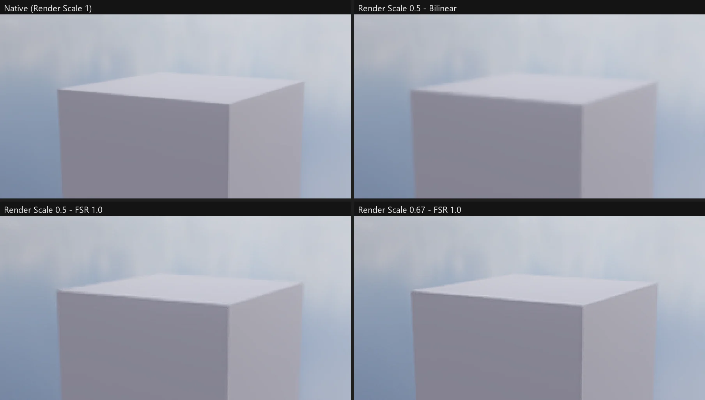

# Render Scale · 업스케일 (FSR 1.0)

Unity URP Asset > Quality 의 **Render Scale** · **Upscaling Filter** 와 같은 설정입니다. Game 카메라 (Game 뷰 · 빌드한 게임) 를 낮은 해상도로 그리고 화면 크기로 늘려 GPU 시간을 아낍니다. 높은 해상도 (1440p · 4K) 에서 큰 월드를 그릴 때 씁니다.



## 쓰는 법

Project Settings > Graphics > **Quality**:

| 설정 | 값 | 뜻 |
|---|---|---|
| Render Scale | 0.1 ~ 2 (기본 1) | 카메라가 그리는 해상도 배율. 0.67 = 1440p 화면을 약 965p 로 |
| Upscaling Filter | Automatic · Bilinear · Nearest-Neighbor · FidelityFX Super Resolution 1.0 | 출력 크기로 늘리는 방법 |
| Override FSR Sharpness · FSR Sharpness | 0 ~ 1 (기본 0.92) | FSR 의 RCAS 날카롭게 하기 세기 (Upscaling Filter 가 FSR 일 때) |

- **Automatic**: 가로 · 세로가 같은 정수 배수면 Nearest-Neighbor, 아니면 Bilinear (URP 와 같음)
- **FSR 1.0**: AMD FidelityFX Super Resolution 1.0 — **EASU** (경계 방향을 따라 늘이는 12 탭 Lanczos 근사, 링잉 막기) → **RCAS** (잘리지 않는 만큼만 날카롭게). 늘릴 때만 — Render Scale 1 이상이면 Bilinear 로 줄인다
- Render Scale 2 = 두 배로 그려 줄이기 (슈퍼샘플링)
- Scene 뷰는 늘 1 (Unity 와 같음). UI (Canvas) 는 늘린 뒤 출력 해상도로 그려 글자가 또렷하다
- 깊이 · SSAO · 그림자 · 후처리 (TAA 지터 포함) 모두 배율 해상도에서 — TAA 와 같이 쓰면 계단 · 반짝임이 적다

설정은 `<프로젝트>/ProjectSettings/GraphicsSettings.json` (`renderScale`, `upscalingFilter`, `fsrOverrideSharpness`, `fsrSharpness`) 에 저장되고 빌드한 게임도 같은 값을 씁니다.

## CLI (`nova renderscale`)

```
nova renderscale get
nova renderscale set --scale 0.67 --filter FSR
nova renderscale set --scale 0.5 --filter FSR --sharpness 0.6     # Override FSR Sharpness 켜고 0.6
nova renderscale set --override false                             # 기본 날카로움 0.92
nova renderscale set --scale 1 --filter Automatic
```

`get` 의 `lastFrame` = 마지막 Game 카메라 프레임 (`active`, `input` 배율 해상도, `output`, 쓴 `filter`, FSR `sharpness`).

## 동작 (엔진 안)

- `EditorApp::OnSceneRender`: 배율 해상도 (반올림) 의 LDR 타깃 (`Upscaler::Target`) 을 만들고, 그 동안 뷰포트 · Game SSAO (`PostProcessingManager::EnsureSSAO`) 를 그 크기로 둔 채 카메라를 그린다 (`RenderCamera` — 깊이 · G-버퍼 · 모션 벡터 · 후처리 모두 뷰포트를 따른다). 끝나면 `Upscaler::Resolve` 가 출력으로
- `Shaders/68. Upscale.fx`: `BilinearTech` · `NearestTech` · `EasuTech` · `RcasTech`. FSR 식은 `ffx_fsr1.h` (MIT, AMD) 의 32 비트 경로를 그대로 옮겼다 — gather 대신 Load 12 번 (OpenGL · Vulkan 변환도 같게), 근사 역수 대신 0 을 막은 나눗셈
- FSR 은 EASU 결과 (출력 크기) → RCAS → 출력. RCAS 세기: 날카로움 s → stops = (1 − s) × 2.5 → exp2(−stops) (URP `FSRUtils` 와 같음)
- 파일: `Source/Graphics/Common/RenderPipelineSettings.*` (설정 · CLI), `Source/Graphics/DX11/Upscaler.*`, `Source/Editor/EditorApp.cpp` (`OnSceneRender`), `Source/Editor/Windows/ProjectSettingsWindow.cpp` (Quality)

## 검사

`Tools/tests/run_tests.ps1 -Only renderscale` — 배율 1 · 0.5 의 입력 크기와 출력 크기, 필터 고르기 (Bilinear · Nearest · FSR, 1 넘으면 Bilinear), 상자 경계 픽셀에서 FSR 이 Bilinear 보다 원래 해상도에 가까움, 설정 저장, Override FSR Sharpness, OpenGL 에서 FSR.

## 아직

- 배율 해상도로 그린 프레임에서는 World · Camera Space 캔버스가 장면 깊이로 가려지지 않는다 (출력 크기 깊이가 없음)
- 시간 업스케일 (Unity 6 STP · FSR 2 — TAA 히스토리를 출력 해상도로), 동적 해상도 (GPU 시간에 따라 배율 자동), 텍스처 밉 바이어스
- C# 에서 바꾸기 (`UniversalRenderPipelineAsset.renderScale`)
