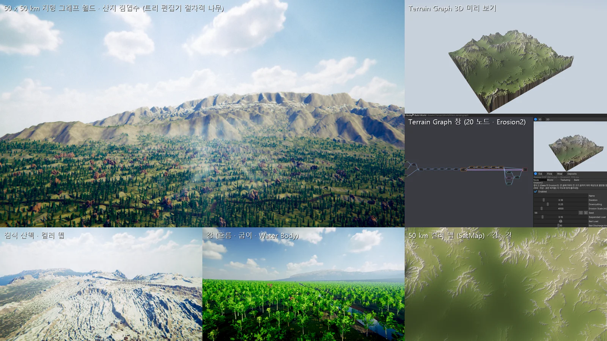

# 지형 그래프 (Terrain Graph) — Gaea 같은 노드 · 침식 지형 생성기

QuadSpinner Gaea 처럼 노드를 이어 지형을 만듭니다. 흐름은 산맥 → 다듬기 → **여러 크기 침식 (Erosion2) · 골 · 퇴적** → **강 · 길** → **색 (SatMap)** 입니다. 결과는 **50 × 50 km** 같은 큰 월드에 1 km 타일 (높이맵 2049²) 로 펼칩니다.

텍스처 (알베도 · 노멀 · 높이) 는 편집기에서 계산으로 만듭니다. 스플랫 맵은 높이 · 경사와 침식이 남긴 물길 · 퇴적, 그리고 길 · 강가 규칙으로 칠합니다. 나무는 트리 편집기의 절차적 나무로, 높이 띠 (바이옴) 에 맞게 자랍니다.



## 쓰는 법

1. **GameObject > Open World > Terrain World 50 km (Graph)** 를 고르면 다음이 한 번에 만들어집니다.
   - `Assets/Terrain/World.terraingraph` (기본 그래프 20 노드)
   - World Terrain
   - 바이옴 식생 PCG (`Assets/PCG/TerrainWorld.pcg`)
   - 그림자 · 숲 화면 Volume

   그래프만 만들려면 Project 창의 **Create > Terrain Graph** 를 씁니다.
2. **Window > Terrain Graph** 로 엽니다. `.terraingraph` 를 더블클릭하거나 World Terrain 인스펙터의 *Open Terrain Graph* 를 눌러도 됩니다.
   - 왼쪽 캔버스
     - 오른쪽 클릭 또는 Space = 노드 추가
     - 출력에서 입력으로 끌기 = 잇기
     - Delete = 지우기
     - 빈 곳 클릭 = Output 미리 보기
   - 오른쪽 위 미리 보기
     - **3D** (Gaea 뷰포트처럼 CPU 광선 행진): 끌기 = 돌리기, 휠 = 확대
     - **2D** 지도
     - 고른 노드를 미리 보기 해상도 (513²) 로 작업 스레드에서 바로 다시 계산합니다.
     - 높이 = 음영, 마스크 = 흑백, 색 (SatMap) = 색으로 보입니다.
   - 탭
     - **Node**: 값
     - **World**: 월드 · 타일 · 디테일 · 컬러 맵 세기 · 메모리 어림
     - **Texturing**: 스플랫 규칙 4 칸 + 계산 텍스처
     - **Build**
3. **Build World** 를 누르면 월드 해상도 (기본 4097² = 50 km 에서 12 m 칸) 로 계산해 `<그래프>.terraingraph.build` 에 저장합니다.
   - 작업 스레드에서 돌고, 진행 상황이 보이며 취소할 수 있습니다. Debug 에서 약 70 초입니다.
   - World Terrain 은 빌드가 끝나면 바로 따릅니다.
   - 빌드에 강이 있으면 **Create Rivers** 가 Water Body (River) 를 만듭니다.
4. **Generate Layer Textures** 는 규칙 이름 (Grass · Dirt · Rock · Snow · Sand) 으로 이음매 없는 알베도 · 노멀 · 높이 PNG 와 `.terrainlayer` 를 만듭니다.
   - 만드는 곳은 `<그래프>_Layers/` 입니다.
   - 레이어마다 이렇게 그립니다.

     | 레이어 | 그리는 것 |
     |---|---|
     | 풀 | 풀잎 하나하나 |
     | 바위 | 깨진 면 · 지층 · 금 · 지의류 |
     | 흙 | 자갈 |
     | 눈 | 바람 결 |
     | 모래 | 물결 |

   - 오목한 곳은 어둡게 구워 넣습니다.

## 노드 (38 종)

| 분류 | 노드 | 하는 일 |
|---|---|---|
| Primitive | Constant · Gradient · Radial · Perlin · Ridged · Mountain · Voronoi | 모양. 좌표가 월드 m 이라 해상도를 바꿔도 같은 땅이 나옵니다 |
| Primitive | **Mountain Range** | 낮은 주파수 띠를 따라 이어진 산맥입니다. 스위스 난류라서 앞 옥타브의 기울기로 다음 옥타브를 밀어, 봉우리 · 능선이 프랙탈로 갈라집니다 |
| Adjust | Combine (Add · Subtract · Multiply · Max · Min · Blend · Difference · Screen + Ratio · Mask) · Warp · Terrace · Curve · Clamp · Normalize · Invert · Blur | 다듬기 |
| Adjust | **Rugged** (Rugged · Crumble · Shatter) | 비탈만 거칠게 만듭니다 (리지 결 · 갈라진 금 · 깨진 덩어리) |
| Adjust | **Stratify** | 기운 지층입니다. 단단한 턱과 무른 비탈이 생기고, Layers 출력 (층 번호) 은 색칠에 씁니다 |
| Simulate | Erosion | 수력 침식 (물방울) |
| Simulate | **Erosion2** | Gaea Erosion2 와 같은 값을 받습니다 (아래) |
| Simulate | Thermal | 무너짐 (애추) |
| Simulate | **Gullies** | 침식 필터로 칸보다 잔 골을 만듭니다 (아래) |
| Simulate | **Sediment** | 오목한 골 바닥 · 낮은 곳을 흙으로 메웁니다 (평평한 골짜기 바닥 · 선상지) |
| Simulate | **River** | 강 (아래) |
| Simulate | **Road** | 길 (아래) |
| Data | Slope · HeightMask · Curvature | 마스크 |
| Primitive | **Dunes** · **Craters** · **Volcano** | 사구 (바람 쪽 완만 · 뒤 가파름) · 운석 구덩이 (테두리 둑) · 화산 (분화구 · 용암 골) |
| Adjust | **Fold** · **Shear** · **Canyon** | 습곡 (눌린 물결) · 단층 (덩어리마다 어긋남) · 협곡 (굽이치는 평평한 바닥 · 층진 벽) |
| Simulate | **Snow** · **Lake** | 눈 쌓임 (눈선 · 경사 · 오목한 곳 — 높이도 올린다, Snow 마스크) · 호수 (빠져나가지 못하는 웅덩이 → Water Body Lake) |
| Color | **SatMap** | 값을 위성 사진에서 뽑은 듯한 색 띠 (팔레트 32 개) 로 바꿉니다 (아래) |
| Color | **Color Blend** | 두 색을 마스크로 섞습니다. 예: 경사 마스크로 바위 색 |
| Output | Height · Flow · Deposits · Wear · Color | 빌드에 저장되는 것 |

### Erosion2

- 값은 Gaea Erosion2 와 같습니다.
  - Duration · Downcutting · Erosion Scale
  - Suspended Load · Bed Load · Coarse Sediments 와 각자의 Discharge Angle
  - Shape · Sharpness · Detail Scale
  - Direction
- **Erosion Scale** 크기의 큰 골짜기부터 반씩 작게, 여러 해상도로 물방울 침식을 합니다. 성긴 격자에서 깎고, 바뀐 양만 쌍선형으로 되돌려 더합니다. 가장 잔 단계는 칸 20 m 입니다 (12 m 칸에서는 물방울이 나란한 잔 골 커튼 무늬를 판다).
- 흙은 퇴적물마다 그 각도까지 흘러내립니다.
- 물방울 침식 자체에 대해:
  - 블록을 2 × 2 색으로 나눠 동시에 돌리므로 잠금 없이 결정적입니다 (같은 그래프 = 같은 결과).
  - 번마다 바뀐 양을 1-2-1 로 고르게 해서 한 칸짜리 구덩이 · 둔덕을 지웁니다.

### Gullies

- Clay John · Rune Skovbo Johansen 의 침식 필터입니다. 비탈 방향을 따라 내려가는 코사인 물결을 칸마다 겹칩니다.
- 옥타브마다 앞 옥타브 골의 옆 비탈을 따라 가지가 갈라집니다.
- 위치의 순수 함수라서 **타일 디테일에도 같은 함수**를 씁니다. 빌드 (12 m) 보다 잔 골이 타일 해상도 (0.5 m) 까지 이어지고, 타일 경계도 맞습니다.

### River

1. 웅덩이를 채웁니다 (Barnes 우선순위 채우기).
2. D8 받는 칸으로 물을 모읍니다.
3. Min Catchment (km²) 를 넘는 칸을 하류로 따라가 강 선을 만듭니다. 큰 강부터 그리고, 합류하면 멈춥니다.
4. 평평한 곳의 D8 곧은 줄은 굽이 노이즈로 옆으로 밉니다 (완만할수록 크게, 끝점은 그대로 — 합류 · 하구가 맞게).
5. 강바닥 (포물선) 과 둑을 팝니다. 물 높이는 굽은 자리의 땅에서 재고, 하류로 갈수록 낮아집니다. 다만 땅보다 6 m 넘게 낮아지지 않습니다 (턱을 넘는 곳에 협곡 벽이 생기지 않게).

### Road

1. 완만한 낮은 땅에 마을을 고르게 둡니다.
2. 최소 신장 트리에 고리를 더해 이을 짝을 정합니다.
3. 칸 사이 기울기가 Max Slope 를 넘거나 피할 곳 (강 마스크) 에 들어가면 비싸지는 A* 로 잇습니다. 이미 낸 길은 싸게 쳐서 길이 모입니다.
4. 높이는 250 m 창으로 고르게 하되 땅에서 6 m 넘게 벗어나지 않게 묶고 (가파른 비탈에서 백 m 깊이의 깎은 벽이 생기지 않게), 다시 40 m 창으로 고릅니다.
5. 노면은 길 높이로 깎고 메웁니다. 어깨는 너비 × 1.5 + 4 m 에 높이 차 × 1.5 (비탈 1:1.5) 를 더해 원래 땅으로 이어집니다.

### Lake

1. 우선순위 채우기로 물이 빠져나가지 못하는 웅덩이를 찾습니다.
2. 수면 아래 칸을 이어 무리로 만들고, Min Depth · Min Area 를 넘는 것만 호수로 둡니다.
3. 바닥을 Fill 만큼 수면 쪽으로 메웁니다.
4. 물가 선 (무어 이웃 경계 따라가기 → 매끈하게) 은 빌드에 저장되고, **Create Water** 가 Water Body (Lake) 로 만듭니다. PCG 물 마스크가 호수에 나무를 심지 않습니다.

### SatMap

- 높이 · 마스크 같은 값을 팔레트 색으로 바꿉니다.
  - 팔레트 분류: Rock · Sand · Green · Blue · Color
  - 손질: Autolevel / Equalize · Bias · Reverse · 색조 · 채도 · 밝기
- Output 의 **Color** 에 이으면 지형 **컬러 맵**이 됩니다.
  - World Settings 의 Color Strength 만큼 텍스처 색을 대신하고, 텍스처는 명암 디테일만 줍니다.
  - 길 · 강가는 텍스처 색 그대로입니다.

## 큰 월드: 용량 · RAM · VRAM

50 km × 50 km 를 1 km 타일 2500 개 × 2049² 로 저장하면 높이만 42 GB 입니다. 그래서 타일은 **저장하지 않고 계산**합니다.

| 무엇 | 크기 |
|---|---|
| 빌드 파일 (4097²): 높이 16 비트 + 물길 · 퇴적 · 깎임 8 비트 + 색 RGB + 강 · 길 선 | 약 130 MB (디스크) · 약 190 MB (메모리, 경사 · 굴곡 포함) |
| 가까운 타일 (Near Distance 700 m 안, 2049²) | 타일마다 RAM · VRAM 각 약 25 MB (높이 + 스플랫 + 컬러 맵), 카메라 둘레 6 ~ 10 개 |
| 중간 (4.5 km 안, 129²) · 먼 (33²) 타일 | 2490 개 합쳐 수십 MB |
| 타일 캐시 (LRU) | 384 MB 까지 |
| 측정 (Debug, 50 km, 카메라 둘레) | 타일 CPU 약 190 MB · GPU 약 180 MB |

**타일 높이** 는 세 가지를 차례로 더하고 고칩니다.

1. 빌드의 쌍삼차 보간
2. **디테일**: 침식 결 fBm 과 Gullies 침식 필터 (빌드 비탈을 따라 가지 친 골)
3. **강바닥 · 길 노면**: 선을 따라 타일 해상도로 날카롭게

모두 월드 좌표 (double) 의 순수 함수라서 **타일 경계가 맞습니다**. 먼 타일은 표본 간격보다 잔 옥타브를 건너뜁니다.

**스플랫** 은 규칙 4 칸으로 정합니다 (0 번이 바탕, 1 ~ 3 번이 위에).

- 규칙이 읽는 값: 높이 · 경사 범위와 부드러운 경계, Flow (물길을 따라 흙), Deposits, Curvature, 노이즈
- 길 · 강가는 흙 칸입니다.

**PCG** 는 같은 높이 · 바이옴을 읽습니다.

| 칸 | PCG 가 놓는 것 |
|---|---|
| 바위 | 돌무더기 |
| 눈 | 아무것도 |
| 길 · 강 위 | 아무것도 |
| 나머지 | 습도 + 물길로 정한 숲 · 초원 |

그 밖에:

- 빌드 파일은 작업 스레드에서 읽습니다 (장면을 열 때 멈추지 않는다).
- 물가 맵 (Water Shore) 은 높이 함수로 한 번만 만듭니다 (타일 LOD 가 바뀔 때마다 2500 개를 돌지 않는다).

## 바이옴 식생 (트리 편집기의 절차적 나무)

PCG Static Mesh Spawner 의 메시 칸에 `tree:Spruce` 처럼 쓰면 모델 파일 대신 트리 편집기 (Tree 컴포넌트 · TreeDesc) 의 그 종을 그립니다.

- 그리는 곳은 TreeRenderer 이고, Tree 컴포넌트 · 지형 나무와 같은 길을 씁니다.
  - LOD 0 · 1 → 8 방향 임포스터
  - 계층 바람
  - 그림자
- 종마다 변형이 2 개 있고 (씨앗 · 키 · 기울기), 점 위치 해시로 고릅니다.

새 종 (`TreeParams` 프리셋 12 개):

| 종 | 모양 |
|---|---|
| Spruce (가문비) | 높고 좁은 원뿔, 처진 가지 |
| Fir (전나무) | 고른 원뿔, 수평 가지 층 |
| Larch (낙엽송) | 성긴 원뿔, 연두 바늘잎 |
| Beech (너도밤나무) | 매끈한 은회색 줄기, 높은 둥근 수관 |
| Dwarf Pine (눈잣나무) | 바람에 눌린 낮은 덤불 소나무, 수목한계선 |
| Dead Pine | 선 채로 죽은 나무 |
| Alder (오리나무) | 물가 |
| Juniper (노간주) | 원뿔 덤불 |

기존 종 Oak · Pine · Birch · Bush 도 그대로 있습니다.

`PCG::MakeBiomeForestPreset` (Terrain World 의 PCG) 은 높이 띠마다 줄을 둡니다. 비율은 최고 높이 기준입니다.

| 줄 | 높이 띠 | 종 |
|---|---|---|
| 저지 활엽수 | 0 ~ 34 % | 너도밤 · 참 · 자작 · 오리 |
| 산지 침엽수 | 26 ~ 68 % | 가문비 · 전나무 · 낙엽송 |
| 수목한계선 | 62 ~ 80 % | 눈잣 · 노간주 |
| 죽은 나무 | 20 ~ 70 % | |
| 초원의 외딴 나무 · 덤불 | | |
| 아래 덮개 · 풀 · 바위 | | 프로젝트 모델 |

## 먼 타일 묶기

World Terrain 은 타일을 G × G 무리로 묶습니다. 50 km 월드면 5 × 5 km, 32 km 면 4 × 4 km 입니다.

- 무리의 모든 타일이 Mid Distance (4.5 km) 너머이면 큰 타일 하나 (257², 20 m) 로 그립니다. 안 타일은 만들지 않고, 있던 것은 놓습니다.
- 가까워지면 안 타일이 다 만들어질 때까지 큰 타일을 그대로 둡니다. 멀어질 때도 큰 타일이 먼저 만들어져 있어 틈이 없습니다.
- 50 km 월드에서 그리는 지형이 약 2500 → 약 300 개로 줄어, 지형 그리기 CPU 가 줄었습니다.
- World Terrain 인스펙터의 Merge Far Tiles 로 끕니다. `world info` 가 `groups` · `farTilesShown` · `drawn` 을 줍니다.

## 절벽 디테일

World 탭의 **Cliff Detail** (기본 6 m) 은 가파른 곳 (22° ~ 42°) 을 타일 해상도로 깹니다. 산맥 리지 (Mountain Range) 가 만든 높이 100 m 넘는 비탈면도 매끈하게 남지 않습니다. 깊이는 경사를 따라 커져 45° 에서 Cliff Detail × 2.5 입니다.

- 깨진 바위 능 · 홈: 리지 노이즈, 60 m.
- 낙석 홈 · 바위 갈비: 침식 필터를 절벽 크기 (80 m) 로 써서 비탈을 따라 내려갑니다. 골은 깊게, 능은 얕게 둡니다.
- 버팀벽 · 큰 골: 220 m 간격으로 비탈을 따라 내려갑니다. 깊이는 그 면의 높이 (경사 방향 ±100 m 의 높이 차) 의 22 % 이고, 40 m 를 넘지 않습니다. 높은 면일수록 깊고, 작은 언덕은 거의 그대로입니다.
- 지층 턱: 16 m 마다 평평한 턱과 가파른 벽이 생기고, 층은 300 m 물결로 기웁니다. 턱 사이 수평 간격이 표본 간격보다 넉넉한 가까운 타일에서만 그립니다 (먼 타일에서는 무아레 띠가 됩니다).

기본 그래프에도 무너짐 (Thermal) 뒤에 **Rugged (Shatter)** 를 둡니다.

## 기후 (식생)

World 탭의 **Climate** 는 PCG 가 식생 종을 고르는 기후입니다 ([절차적 식생](VEGETATION.md)).

- **Sea Level Temperature**: 해수면 연평균 기온 (°C). 높이 1 km 마다 6.5 °C 내려갑니다.
- **South-North Difference**: 남쪽 끝과 북쪽 끝 (z) 의 기온 차.
- **Moisture** · **West-East Moisture Difference**: 기본 습도와 서쪽 끝 · 동쪽 끝 (x) 의 습도 차.
- 물길 · 퇴적이 습도를 올리고, 강가 60 m 는 물가로 칩니다 (버드나무 · 갈대 · 부들).

예: 50 km 테스트 월드 (15 °C, 남북 -12 °C, 습도 0.55, 동서 +0.35) 는 이렇게 나뉩니다.

- 남쪽 저지: 21 °C 의 지중해 · 아열대 (올리브 · 우산소나무 · 대나무 · 라이브오크)
- 북쪽: 냉대 (가문비 · 자작 · 사시나무)
- 산 위: 고산 · 툰드라
- 서쪽: 건조하고, 동쪽: 습합니다.

## 성능 (Release, 편집기 Game 뷰, 숲 · 강 28 개 · 길 17 개 · PCG 인스턴스 17 ~ 22 만)

| 단계 | 프레임 |
|---|---|
| 처음 | 87 ~ 103 ms |
| 물 바디 곡선 캐시 (강 28 개 — 물에 잠겼나 · PCG 물 마스크가 프레임마다 4 m 곡선을 다시 뽑았다) + PCG 물 마스크 격자 | 38 ms |
| 지형 효과 변수 이름 찾기 캐시 · 높이 배열 키 (문자열 → 해시) · 잎 + 스커트 한 번에 · 먼 타일은 테셀레이션 없이 | 30 ms |
| 3 km 너머 타일은 깊이 · 법선 프리패스에서 뺀다 (GPU 프리패스 15.6 → 1.4 ms) | **20 ~ 34 ms** (GPU 7 ~ 15 ms — 하늘 · 다가가기 20 ms, 강가 · 길 33 ms) |

| 먼 타일 묶기 (5 × 5 km 큰 타일 — 그리는 지형 약 2500 → 340 ~ 390 개, 그 가운데 큰 타일 90 개) | 13 ~ 22 ms (GPU 7 ~ 13 ms) |
| 절벽 디테일 (더 무겁다) + 지형 LOD 최소 삼각형 2.5 픽셀 + PCG 게으른 높이 | **10 ~ 20 ms** (GPU 6 ~ 13 ms — 하늘 9.9 ms, 다가가기 11.5 ms, 숲 11.3 ms, 강가 13.4 ms, 길 20 ms (PCG 인스턴스 20 만)) |

남은 CPU 는 나무 모으기 · MeshBatcher 입니다 (PCG 인스턴스가 많은 길 화면이 가장 무겁다).

절벽 디테일은 높이에 잔 고주파를 더하므로 지형 LOD 가 600 m 밖에서도 0.5 m 칸 (1 픽셀보다 작은 삼각형) 을 골랐습니다 (다가가기 GPU 9.6 → 19.3 ms, 깊이 프리패스 1.6 → 6.3 ms). 이제 지형 쿼드트리는 쪼갠 칸이 화면에서 2.5 픽셀보다 작아지면 오차가 커도 쪼개지 않습니다 (모든 Terrain).

PCG 셀은 지형 높이를 점이 닿는 격자점만 계산합니다. 예전에는 셀 전체 격자 (0.49 m 간격) 를 미리 계산해 셀마다 115 ms, 50 km 월드의 셀 9700 개가 다 차는 데 8 분 넘게 걸렸습니다. 이제 셀마다 12 ms, 약 40 초입니다.

## 여러 지형 (Terrain 오브젝트)

World Terrain 대신 보통 **Terrain** 을 쓰고 싶으면 (손으로 칠하기 · 나무 칠하기) 이렇게 합니다.

- **Build > Create Terrain Tiles**: 타일 번호 (x, z) 부터 n × n 개를 `.terraindata` 로 만들어 월드 위치에 놓습니다. 높이 · 스플랫 · 레이어 · 컬러 맵도 넣습니다.
- **Build > Apply To Scene Terrains**: 장면의 Terrain 들에 월드 위치 그대로 적용합니다. 경계가 맞습니다 (자동 검사에서 이음매 0 m).

## 지형 반사

지형 셰이더의 환경 반사를 지형만 0.3 배로 낮췄습니다. 풀잎 · 자갈이 비스듬한 하늘 반사를 가리기 때문이고, 이전에는 먼 비탈이 하얗게 번들거렸습니다. 매끄러움은 0.05 입니다. 젖은 땅 · 웅덩이에서는 반사가 돌아옵니다.

## 바이옴 텍스처 (World Terrain — 50 km)

지형 레이어는 넷 (풀 · 흙 · 바위 · 눈 — 레이어 이름이 역할) 이지만 큰 월드는 사막부터 툰드라까지 기후가 다르다. World Terrain 의 **Biome Textures** (기본 켬) 는 역할마다 **바이옴에 맞는 텍스처 팩 사진 재질** 을 쓴다.

- 타일마다 **기후 맵** (64², 가장자리 포함 — 이웃 타일과 같은 값): 그래프의 `BiomeAt` 의 기온 (해발 −6.5 °C/km) · 습도 · 물가. 타일 작업 스레드가 만들고 캐시에 함께
- 셰이더가 기후 (± 14 m · 90 m 노이즈로 경계를 흔든다) 로 가장 가까운 **바이옴 둘** 을 골라 섞는다 — 역할 4 × 바이옴 2 = 가상 레이어 8, 높이 기반 섞기 (경계에서 돌 · 흙이 먼저 드러난다) · 테셀레이션 변위 · 범프 · 거칠기 (사진의 roughness — 진흙 · 젖은 모래 · 눈이 반들). 깊이 · 그림자 패스도 같은 식
- 컬러 맵 (SatMap) 은 멀리서만 (180 m → 900 m 에서 다 들어온다) — 가까이는 사진 그대로
- 재질은 배열 둘 (색 RGBA8 — a 거칠기 · 높이 + 노멀 RGBA8, 높이는 색의 절반 크기), 쓰는 재질만 (기본 월드 24 장, 1024² ≈ 170 MB · 512² ≈ 42 MB — **Texture Size**). 처음엔 작업 스레드가 사진을 읽는 동안 레이어 텍스처 그대로
- 텍스처 팩이 없거나 꺼지면 예전처럼 레이어 텍스처

| 바이옴 | 기온 · 습도 | 풀 | 흙 | 바위 | 모래 |
|---|---|---|---|---|---|
| Temperate Forest | 9 °C · 0.6 | wild-grass | forest-floor | cliff-grey | river-pebbles |
| Boreal | −1 · 0.55 | mossy-forest | pine-needles | cliff-dark | gravel |
| Tundra / Alpine | −9 · 0.45 | sparse-grass | rocky-dirt | lichen-rock | gravel |
| Hot Desert | 27 · 0.08 | dry-ground | desert-sand-gravel | red-desert | sand |
| Savanna / Steppe | 22 · 0.3 | dry-grass | red-laterite | sandstone-cliff | desert-sand-gravel |
| Tropical Rainforest | 25 · 0.85 | forest-leaves-green | mud | cliff-mossy | wet-sand |
| Mediterranean | 16 · 0.32 | grass-dirt | soil | cliff-light | sand |
| Wetland | 11 · 0.95 | mud-clover | mud | mossy-rock | wet-sand |

눈 역할은 모든 바이옴에서 `ground/snow`. 표는 [TerrainBiomeTextures.cpp](../Source/Terrain/TerrainBiomeTextures.cpp). `nova world info` 의 `biomeTextures` = 상태 (재질 수 · GPU MB).

## 풀밭 (World Terrain — 빽빽한 풀 · 낮은 풀)

World Terrain 의 바이옴 지형 위에 카메라 둘레를 풀로 덮는다 (`Source/Scene/GrassField.*`, `Shaders/49. GrassField.fx`). 메시 · 인스턴스 버퍼 없이 **정점 셰이더가 풀잎을 만든다** (SV_VertexID · SV_InstanceID).

- **월드에 붙은 겹 격자**: 점 간격 0.4 m. 점 번호의 끝 0 비트 수 = 단계 — 거리 d 에서 `L(d) = 0.75 · log2(d / 10)` 보다 낮은 단계의 점은 사라지고, 남은 점의 덩어리는 2^L 배 넓어진다. 카메라가 움직여도 점이 제자리라 깜빡이지 않는다
- **패치**: 월드 타일마다 쿼드트리 (16 m 까지). CPU 가 조절 맵 (32 × 32) 으로 길 · 강 · 바위 · 눈 · 모래 · 비탈을 먼저 빼고, 가까운 것부터 그린다. 한 프레임 1600 만 정점 예산
- **풀잎**: 가까운 단계 9 잎 · 3 마디 → 멀면 4 잎 · 1 마디. 분수처럼 벌어지고 바람 (날씨의 바람 세기 · 방향) 에 흔들린다. 색은 바이옴 풀 재질 (지형 albedo 배열의 밉 5), 일부는 마른 잎
- **바이옴별**: 밀도 · 키 · 마름 · 너비 (열대 우림 · 습지는 빽빽하고 키 크게, 사막 · 툰드라는 드물게). 표는 `GrassField.cpp` 의 `kBiomeGrass`
- **그리기**: 메인 패스만 (깊이 LESS_EQUAL), 그림자 · 프리패스 없음 — 50 km 월드 (Debug) 약 8 만 점 · 450 만 정점 · GPU 약 3 ms

Inspector (World Terrain → Grass): `Dense Grass` · `Density` (1 = 가까운 곳 약 10 덩어리 / m²) · `Distance` (기본 320 m) · `Height`. 저장 키 `grass{enabled, density, distance, height}`. `nova world info` 의 `grass` = 패치 · 점 · 정점 · 빠진 패치 · CPU ms.

## 사진 레이어 (텍스처 팩)

`terraingraph textures <g>` (창의 Generate Layer Textures) 는 프로젝트에 텍스처 팩 (com.nova.textures) 이 있으면 레이어마다 **사진 PBR 재질** 을 고른다: 규칙 이름 낱말로 땅 · 바위 분류를 찾고 (예 "Forest Floor" → `ground/forest-floor`, "Cliff" → `rock/…`), 없으면 종류의 기본 (풀 `ground/wild-grass` · 흙 `ground/forest-floor` · 바위 `rock/cliff-grey` · 눈 `ground/snow` · 모래 `ground/sand`). 레이어 파일에는 재질 id 만 (`"material"`), 타일 3 ~ 6 m, 높이 변위 6 ~ 35 cm (바위는 30 cm 넘게 — 붉은사막처럼). `--source procedural` = 예전처럼 식으로 굽는 PNG.

## CLI

```
nova terraingraph new Assets/Terrain/W.terraingraph --seed 7
nova terraingraph world Assets/Terrain/W.terraingraph --values "{\"worldSize\":50000,\"tileResolution\":2049}"
nova terraingraph preview Assets/Terrain/W.terraingraph --res 1025 --mode color --out map.png --out3d view.png --yaw 215 --pitch 32
nova terraingraph build Assets/Terrain/W.terraingraph
nova terraingraph textures Assets/Terrain/W.terraingraph --size 1024
nova terraingraph attach Assets/Terrain/W.terraingraph
nova terraingraph rivers Assets/Terrain/W.terraingraph
nova terraingraph grid --x 0 --z 0 --step 1000 --count 49
nova world probe --x 100 --z 200
```

그 밖의 명령은 [NOVA_CLI.md](NOVA_CLI.md) 에 있습니다: `info` · `graph` · `add --type snow` (노드 더하기 → 번호) · `connect --from --fromPin --to --toPin` · `set` · `enable` · `layer` · `cancel` · `height` · `apply` · `tiles` · `seams` · `window --node N`. 마지막의 `world probe` 는 높이 함수와 그려지는 타일 높이의 차를 돌려줍니다.

## 검사

`Tools/tests/run_tests.ps1 -Only terraingraph` 는 4 km 작은 월드로 약 1 분 걸립니다. 확인하는 것:

- Gaea 식 기본 그래프
- 계산 (침식이 높이를 바꾸고 물길을 만든다)
- 강 · 길 · 색이 나온다
- 같은 그래프 = 같은 결과
- 노드 끄기
- 빌드
- 2 × 2 Terrain 이음매
- 계산 텍스처
- 빌드의 색 · 강 · 길과 Water Body
- World Terrain 스트리밍 (같은 높이, 메모리)

## 아직

- 노드: Gaea 의 Glacier · Sea · Island · Flow Map 같은 것, 노드 묶음 (그룹)
- 빌드를 타일로 나눠 더 큰 해상도 (8193² 넘게)
- GPU 침식 (컴퓨트)
- 길 메시 (지금은 지형을 깎고 흙으로 칠한다) · 다리
